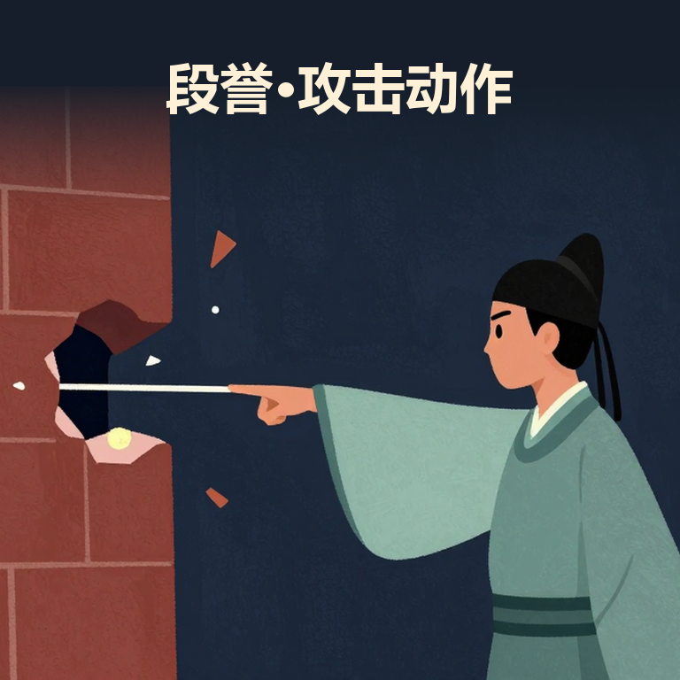

# 段誉·攻击动作

《杀戮尖塔 2》角色模组「大理世子·段誉」的独立演出扩展。



## v1.3.0

重绘战斗待机立绘。打击、无意一指和六脉剑气改用模型生成的逐帧动作。出招与命中同步，六种剑气保留各自的颜色和弧线。

## 角色选择页

选中段誉后，游戏在原生界面背后循环播放动态插画。扩展将插画帧打包进 DLL。帧资源不可用时，页面显示段誉的静态立绘。

## 战斗演出

- 战斗待机立绘采用青衫、深色袖口和腰带的少年段誉设计。
- 普通攻击旋身推掌，「无意一指」收肘后向前出指。两套动画各含 12 帧，出手关键帧在伤害结算时显示。
- 六脉剑气各有颜色和飞行弧线。「中冲剑气」会向每名实际命中的敌人发出剑气。

扩展提供角色选择页和战斗演出。

## 安装

启用「大理世子·段誉」v0.5.30 或更新版本及其 BaseLib 依赖。可以在创意工坊订阅动作扩展，也可以使用 GitHub 安装包，将 `DuanYuAttackAnimation` 文件夹解压到游戏目录中的 `mods`，重启后在模组管理中启用。详见[安装说明](安装说明.md)。[动作扩展](https://steamcommunity.com/sharedfiles/filedetails/?id=3845078140) · [段誉主模组](https://steamcommunity.com/sharedfiles/filedetails/?id=3841781260) · [GitHub 下载](https://github.com/cqbzly/sts2-duan-yu-attack-animation/releases/latest)

测试环境为 Windows《杀戮尖塔 2》v0.113.1。打击、无意一指和六种剑气均触发演出，群攻覆盖三名敌人。

## 构建

使用 .NET 9 SDK，指定本机《杀戮尖塔 2》安装目录。构建引用游戏自带的程序集。

```powershell
dotnet build .\DuanYuAttackAnimation.csproj -c Release "-p:Sts2Path=D:/steam/steamapps/common/Slay the Spire 2"
```

安装文件包括生成的 `CQBZLY_DUAN_YU_ATTACK_ANIMATION.dll` 与同名 JSON 清单。

构建时，项目将 `assets/selection-atlas-*.jpg` 和 `assets/combat-*.png` 嵌入 DLL。
